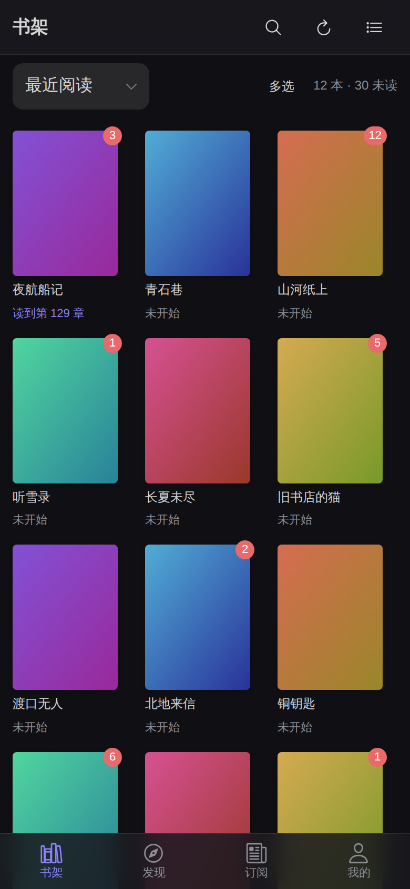
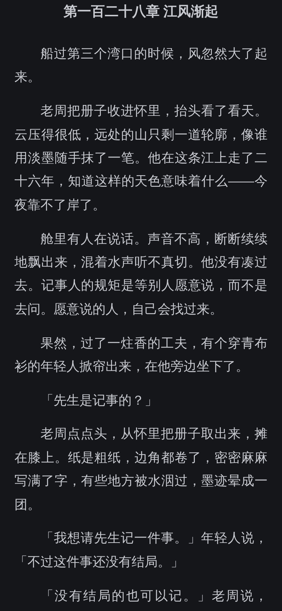
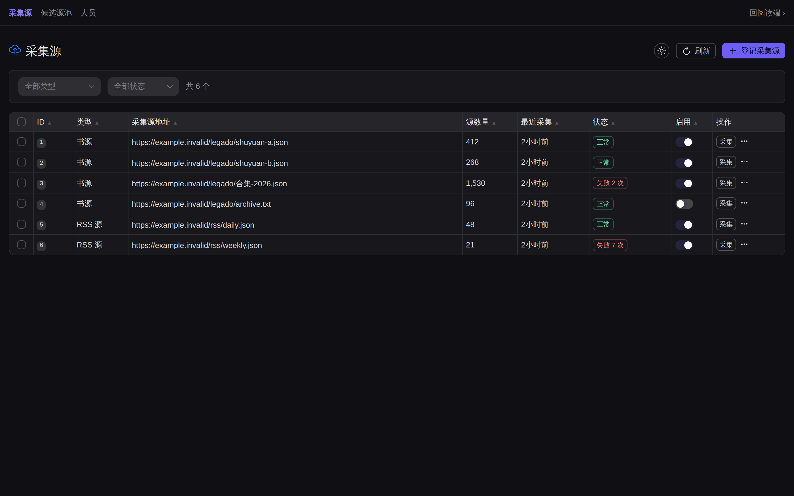

# funread-web

[funread-api](https://github.com/farfarfun/funread-api)（依赖 [funread](https://github.com/farfarfun/funread) 核心库）的采集源管理界面。

<p align="center">
  
  
  
</p>

<p align="center"><sub>
截图由 <a href="scripts/shots.mjs"><code>scripts/shots.mjs</code></a> 在每次打 tag 时自动重截（<a href=".github/workflows/shots.yml">shots.yml</a>）。
里面的书名和正文都是脚本里写死的假数据 —— funread 不自带任何内容，读的是你自己配的书源。
</sub></p>

| 组件 | 默认地址 |
| --- | --- |
| 前端（静态页面 + 内部 API 转发） | `http://127.0.0.1:8811` |
| `funread-api` 后端 | `http://127.0.0.1:18811` |

生产态 Web 服务默认只监听本机。需要手机或局域网设备访问时，先在后端
`config.toml` 配置 `[auth] password` 并注册首个管理员账号，再在 Web 服务的
`config.toml` 设置 `[server] host = "0.0.0.0"`。

## 快速开始

```bash
# 终端 A
cd ../funread-api
uv run funread-api server run    # 库地址来自 ~/.farfarfun/funread/config.toml

# 终端 B
cd ../funread-web
pnpm install
pnpm dev
```

浏览器只请求同源 `/api`；Vite 默认转发到 `127.0.0.1:18811`。后端地址不同时，`pnpm dev`
下在 `.env.local` 里设 vite 的构建期变量 `FUNREAD_API_BASE_URL`；生产态服务端
（`funread-web server run`）用 `--backend` 或 config.toml 的 `[server] backend`。页面支持登记、筛选、排序、分页、启停、立即采集、重置刷新时间、
单条/批量删除以及操作队列反馈。

## 移动端：两个 Android 客户端

两套 Capacitor 工程、两个包名，**可以装在同一台手机上对比**。打 `v*` tag 时 CI 会把
两个 debug APK 都传到 [GitHub Release](https://github.com/farfarfun/funread-web/releases)
上，直接下载安装。

| | funread light（`mobile/`） | funread 打包版（`mobile-packaged/`） |
| --- | --- | --- |
| Web 资源 | 不打包，`location.replace` 到用户服务器 | **打进 app** |
| 页面来源 | 用户的服务器 | `http://localhost` |
| 认证 | 同源 cookie 会话 | **`Authorization: Bearer <设备 token>`** |
| 离线启动 | 要网络 | 能 |
| 包名 | `com.farfarfun.funread.light` | `com.farfarfun.funread` |
| 服务端要求 | 任意版本 | 要有 `POST /auth/tokens/issue` |

**light** 只带一个启动页，填完地址就把整个窗口交给那台服务器上的这同一个 `/web`。
页面来源是用户的服务器，`/api` 同源，cookie 会话原样生效 —— **后端一行都不用改**。
代价是启动必须有网络，这是预期行为。

**打包版**把 `dist` 装进 app，于是请求用户服务器成了跨站，cookie 发不出去
（后端 `allow_credentials=False`）。它改用设备 token：首次启动填地址 + 账号口令，
换一条长期凭据存在本机；「我的 → 我的设备」能看到所有设备并单条吊销。

```bash
cd mobile && npm install && npm run sync                    # light
cd mobile-packaged && npm install && npm run build:www && npm run sync   # 打包版
```

细节、踩过的坑、iOS 为什么未经验证，在各自的 README 里：
[mobile/README.md](mobile/README.md)、[mobile-packaged/README.md](mobile-packaged/README.md)。

## 桌面端：同样两个客户端

两套 [Tauri 2](https://v2.tauri.app/) 工程，形态和上面两个 Android 客户端一一对应，
应用标识也不同，**可以装在同一台机器上对比**。打 `v*` tag 时 CI 会把它们和 APK 一起
传到同一个 Release 上。

| | funread light（`desktop/`） | funread 打包版（`desktop-packaged/`） |
| --- | --- | --- |
| Web 资源 | 不打包，`navigate()` 到用户服务器 | **打进应用**（同一份 `dist-packaged/`） |
| 页面来源 | 用户的服务器 | `tauri://localhost` |
| 认证 | 同源 cookie 会话 | **`Authorization: Bearer <设备 token>`** |
| 应用标识 | `com.farfarfun.funread.light` | `com.farfarfun.funread` |
| 产物 | `funread-light-<tag>-{linux,windows,macos}.*` | `funread_<版本>_<架构>.deb`、`funread-<版本>-macos-<架构>.dmg` 等 |

**两套产物名**。打包版按 [farfarfun/packages](https://github.com/farfarfun/packages)
的接入规范拼（`docs/package-spec.md`）：版本号不带 `v`，`.deb` 用下划线分隔、
macOS 分 `arm64` / `amd64` 两个 dmg，外加一个覆盖全部附件的 `SHA256SUMS`。组织的
APT 源和 Homebrew tap 是**按文件名**认版本和架构的，差一个字就收不进去。light 不进
包仓库 —— 它装完还要填服务器地址，不适合「装上就能用」的包管理器分发 —— 名字沿用
原来的，继续只在 Release 页面提供。

**Tauri 而不是 Electron**：Electron 每个 app 自带一份 Chromium（100MB 起步），
Tauri 用系统 WebView，壳本身是个位数 MB。对一个自托管小工具这个差距没有道理。
代价是 Linux 上的渲染行为取决于用户装的 WebKitGTK 版本，所以产物固定在
ubuntu-22.04 上构建（标准源里带 webkit2gtk-4.1 的第一个 LTS，也是 AppImage 的
glibc 基线）。

两件桌面特有的事：

- **light 版的地址是运行时的。** `tauri.conf.json` 里的 URL 和 Capacitor 的
  `server.url` 一样是构建期配置，所以同样走「本地启动页 + 跳转」，只是跳转由 Rust
  的 `WebviewWindow::navigate()` 发起，探活也挪进了 Rust。
- **打包版的 API 请求从 Rust 发出去。** Tauri 的页面来源不在 funread-api 的 CORS
  白名单里，而且 WebKit 把 `tauri://` 当不透明来源、发出去的 `Origin` 是空的 ——
  加白名单在 Linux / macOS 上也救不回来。换掉 `fetch` 是壳层的事，Vue 一个字都没改。

**所有桌面产物都没有签名**，也没有做 macOS 公证。第一次打开要绕过系统拦截，方法写在
Release 说明和各自的 README 里：
[desktop/README.md](desktop/README.md)、[desktop-packaged/README.md](desktop-packaged/README.md)。

```bash
cd desktop && cargo tauri build                                   # light
pnpm run build:packaged && cd desktop-packaged && cargo tauri build   # 打包版
```

### Vue 这边怎么区分两种形态

一份源码出两种产物，分界是构建模式：

- `pnpm run build` → `dist/`，给浏览器、也给 light 套壳加载。同源 `/api`，cookie。
- `pnpm run build:packaged` → `dist-packaged/`，打进 app。跨站基址 + Bearer。

判定用的是 `vite build --mode packaged` 注入的构建期常量 `__FUNREAD_PACKAGED__`，
不是运行时探测 —— 这样浏览器那份产物里连 `Authorization` 这个词都不会出现，
浏览器和 light 的行为分毫不变。理由写在
[`src/api/packaged.ts`](src/api/packaged.ts) 顶部，两个方向的断言分别在
`tests/bundle.test.js` 和 CI 的 `android-packaged` job 里。

四套客户端工程都不进 npm 包：`package.json` 的 `files` 是白名单
（`bin`/`server`/`dist`），`tests/packaging.test.js` 盯着它别被改坏。

---

## 关于 farfarfun

[farfarfun](https://github.com/farfarfun) 是一个专注于实用工具库的开源组织，
涵盖云存储、数据处理、AI、多媒体与开发工具链等方向。

- 🏠 组织主页：<https://github.com/farfarfun>
- 📧 联系：farfarfun@qq.com

本项目基于 [MIT](LICENSE) 协议开源。
